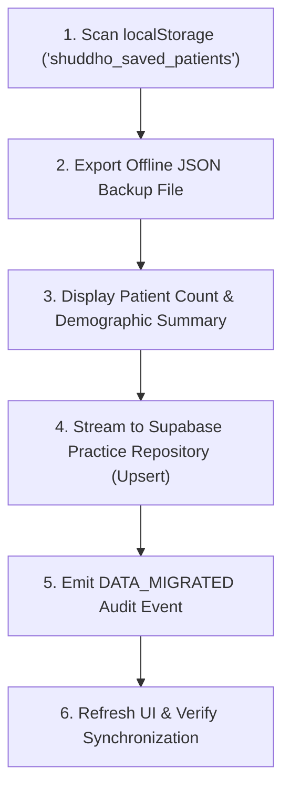

# Local-to-Cloud Data Migration Guide

**Document ID:** SHUDDHO-DOC-R2-007  
**Module:** `DataMigrationWizard`  
**Source:** Browser `localStorage` (`shuddho_saved_patients`)  
**Target:** Supabase PostgreSQL (`public.patients`, `public.visits`, `public.nutrition_plans`)  

---

## 1. Migration Overview

Practitioners who began using SHUDDHO in offline or demo mode can seamlessly transition their local patient rosters into the secure Supabase multi-tenant cloud backend without losing consultation records or diet plans.

---

## 2. Ingestion Workflow

---

## 3. Safety & Rollback Protocol

1. **Mandatory Offline Backup:** Prior to database upload, clinicians can download an offline JSON backup with one click.
2. **Idempotent Upsert:** Patient records are upserted using `ON CONFLICT (organization_id, client_id) DO UPDATE`, preventing duplicate row errors.
3. **Audit Trail Integrity:** The migration wizard automatically records a `DATA_MIGRATED` audit event documenting the exact count of imported records.
