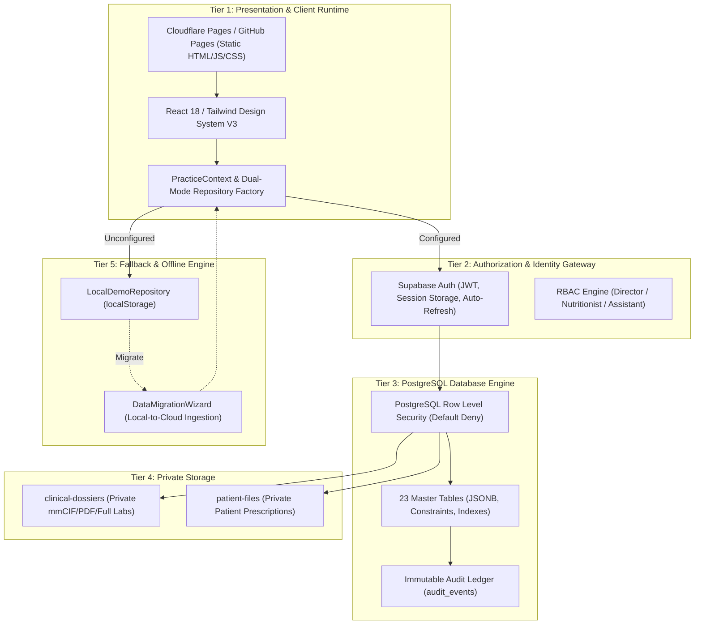

# SHUDDHO R2 Secure Backend Foundation: System Architecture

**Document ID:** SHUDDHO-DOC-R2-001  
**Version:** 1.0.0  
**Phase:** R2 Secure Multi-Tenant Cloud Architecture  
**Release Target:** Production / Cloudflare Pages / Supabase  
**Audited Master Entities:** 23 Master Tables + Support Structures  

---

## 1. Executive Summary & Core Invariants

The **SHUDDHO Clinical Functional & Precision Nutrition Platform** is a specialized clinical intelligence system designed for licensed practitioners managing complex metabolic and functional health conditions.

Phase **R2** establishes an enterprise-grade, secure, multi-tenant cloud backend powered by **Supabase PostgreSQL**, while strictly maintaining compatibility with Next.js Static Export (`output: 'export'`) deployed across both **Cloudflare Pages / Workers** (primary domain root) and **GitHub Pages** (secondary path demo).

### Architectural Invariants
1. **Static Export Preservation:** Zero Node.js runtime server dependencies, Server Actions, or Next.js API route handlers. All database queries, authentications, and file interactions occur via `@supabase/supabase-js` using standard HTTPS/WSS protocols directly from the client.
2. **Zero-Trust Row Level Security (RLS):** Default deny on all 23 master database tables. Clinical and patient access is constrained by cryptographically verified JWT tokens issued by Supabase Auth and evaluated by PostgreSQL RLS policies.
3. **Multi-Tenancy Isolation:** Strict multi-clinic practice isolation (`organizations`). Clinicians can only query and mutate data belonging to clinics where they have active membership.
4. **Role-Based Access Control (RBAC):** Three clinical roles:
   - `CLINICAL_DIRECTOR`: Full clinical, administrative, and directory governance.
   - `TREATING_NUTRITIONIST`: Clinical assessment, diagnosis, prescription, and plan approval.
   - `ASSISTANT_DIETITIAN`: Drafting, data intake, meal planning assistance. **Strictly prohibited from signing or releasing clinical nutrition prescriptions.**
5. **Immutable Clinical Audit Trail (U18):** `audit_events` is an append-only ledger. PostgreSQL RLS strictly forbids `UPDATE` and `DELETE` on all audit logs.
6. **Graceful Offline / Demo Degradation:** If Supabase credentials (`NEXT_PUBLIC_SUPABASE_URL`, `NEXT_PUBLIC_SUPABASE_PUBLISHABLE_KEY`) are unconfigured, the application runs in a clearly marked Local Demo mode backed by browser `localStorage` without crashes or blank screens.

---

## 2. 5-Tier Data Architecture

---

## 3. Dual-Deployment URL Invariants

| Hosting Target | Base URL | Routing | Supabase Integration |
|---|---|---|---|
| **Cloudflare Pages / Workers (Primary)** | `https://shuddho-nutrition.probalofficial007.workers.dev/` | Root (`/`) | Live Backend with Auth & RLS |
| **GitHub Pages (Secondary)** | `https://probalsarpv-byte.github.io/Diet-Chart-Software/` | Subpath (`/Diet-Chart-Software/`) | Live or Local Demo Fallback |

---

## 4. Repository Abstraction Pattern

The frontend consumes all clinical data through the `IPracticeRepository` interface (`src/repositories/types.ts`):
- `SupabasePracticeRepository`: Direct PostgreSQL client using typed table queries, optimistic locking, and automatic audit event logging.
- `LocalDemoRepository`: In-memory and `localStorage` persistence with identical method signatures for offline testing and demo mode.
- Factory (`getPracticeRepository`): Automatically resolves active repository based on `isSupabaseConfigured()`.
